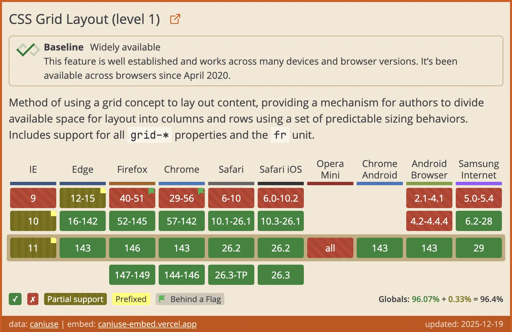
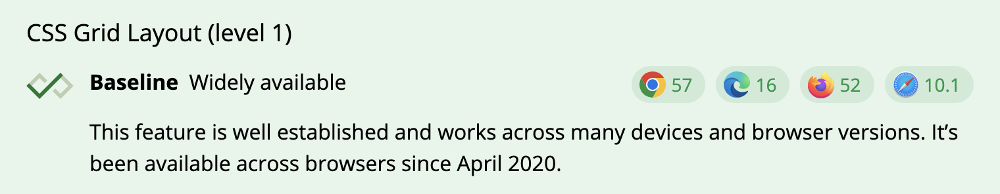

# CanIUse Embed

Embed up-to-date data from [caniuse.com](https://caniuse.com/),
[mozilla's browser compat data](https://github.com/mdn/browser-compat-data) and
[web-platform-dx/web-features](https://github.com/web-platform-dx/web-features).

Displays feature support data for multiple versions of the 10 major browsers.

Configurable, reliable, and fully responsive.

## Document

See [Documentation](https://caniuse-embed.vercel.app/) for more details.

## Usage

Include the following javascript file in your document.

```html
<script type="module" src="https://caniuse-embed.vercel.app/embed.js"></script>
```

If the primary domain is unreachable, the same site is also served from the
mirror domain `caniuse.pengzhanbo.cn`, which can be used instead:

```html
<script type="module" src="https://caniuse.pengzhanbo.cn/embed.js"></script>
```

Paste this snippet where you want the embed `caniuse` to be displayed:

```html
<p class="ciu-embed" data-feature="{feature}" data-past="2" data-future="1"></p>
```

Or use the following snippet for `baseline` data:

```html
<p class="ciu-baseline-embed" data-feature="{feature}"></p>
```

### Parameters

| Attribute | Description | Default |
| --- | --- | --- |
| `data-feature` | Feature id, e.g. `css-grid` / `mdn-css_properties_z-index` | - |
| `data-past` | Number of past version groups to display, `0 - 5` | `2` |
| `data-future` | Number of future version groups to display, `0 - 3` | `1` |
| `data-theme` | `light` / `dark` / `auto` | `auto` |
| `data-origin` | Optional data source origin, must be an absolute `http(s)` URL | `https://caniuse-embed.vercel.app` |

`embed.js` is a bundled module script without top-level imports, so it also works
when the `type="module"` attribute is omitted.

## Example





## Why ?

In the past, I often embedded CanIUse data in my technical documents using [https://caniuse.bitsofco.de/](https://caniuse.bitsofco.de/). However, I found that when embedding it, it required loading [@mdn/browser-compat-data](https://github.com/mdn/browser-compat-data) (14MB) and [caniuse/full-data.json](https://github.com/Fyrd/caniuse) (4MB), totaling over 18MB of data, and then needed to be parsed at runtime, resulting in less than 10kb of effective data.

**This consumes too much traffic and seriously affects loading speed!**

Therefore, I decided to redevelop using [Astro](https://astro.build/) and deploy to [Vercel](https://vercel.com/).

By using **Astro** static site generation, a completely independent static page is generated for each feature without requesting any data, and each page is around 12–16 KB in size!

Meanwhile, a Github Actions cron job triggers the **Vercel** deployment hook every weekend, regenerating pages so that the data stays up to date.

## Development

```bash
pnpm install
pnpm dev      # start dev server
pnpm gendata  # regenerate data/cached.json from remote data
pnpm test     # run unit tests (vitest)
pnpm check:data # data sanity assertions against the installed datasets
pnpm check    # astro check (type check)
pnpm lint     # eslint
pnpm build    # astro check + astro build
```

Data sources:

- `@mdn/browser-compat-data` (npm)
- `caniuse-db` (npm, `fulldata-json/data-2.0.json`)
- `web-features` (npm)

Production builds always use the **latest published version** of each package: the version is
resolved through jsDelivr before fetching, so the weekly automated build always ships the
freshest compatibility data (`@master` style moving branches are avoided). The resolved
versions are printed in the build log.

Local development reads the packages installed in `node_modules` (fast, works offline).
To reproduce an older build, pin the versions explicitly:

```bash
CIU_BCD_VERSION=8.1.11 CIU_CANIUSE_VERSION=1.0.30001828 CIU_WEBFEATURES_VERSION=3.48.0 pnpm build
```

## Thanks

- [mdn-browser-compat-data](https://github.com/mdn/browser-compat-data)
- [Fyrd/caniuse](https://github.com/Fyrd/caniuse)
- [web-platform-dx/web-features](https://github.com/web-platform-dx/web-features)
- [ireade/caniuse-embed](https://github.com/ireade/caniuse-embed)

## LICENSE

MIT
