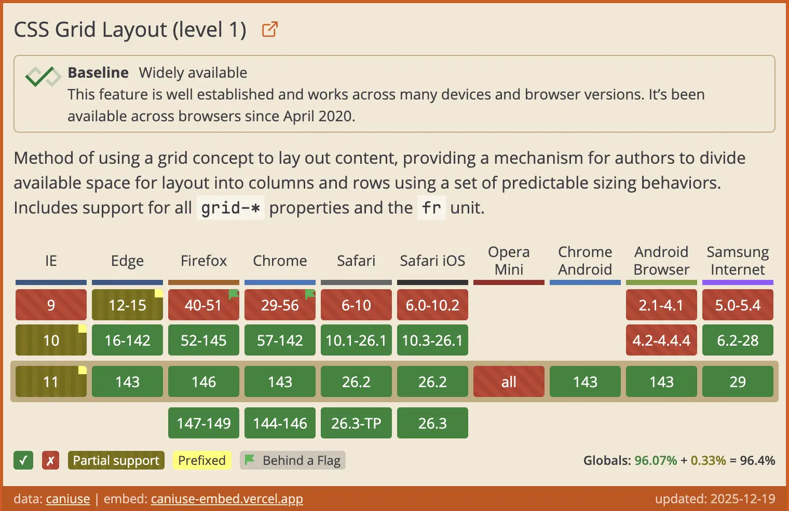
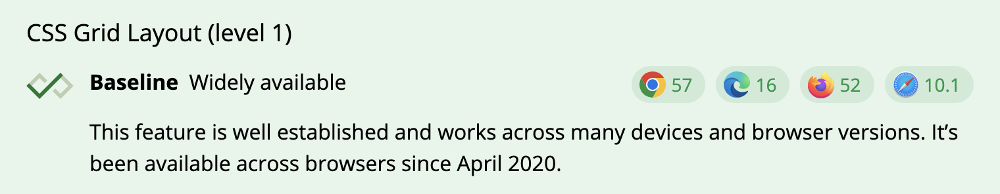

# CanIUse Embed

从[caniuse.com](https://caniuse.com/)、[mozilla的浏览器兼容数据](https://github.com/mdn/browser-compat-data)和
[web-platform-dx/web-features](https://github.com/web-platform-dx/web-features)嵌入最新的数据。

显示10个主要浏览器多个版本的功能支持数据。

可配置、可靠且完全响应。

## 文档

查看 [文档](https://caniuse-embed.vercel.app/) 。

## 使用

在您的文档中插入以下 JavaScript 代码。

```html
<script type="module" src="https://caniuse-embed.vercel.app/embed.js"></script>
```

如果主域名无法访问，同一站点也通过镜像域名 `caniuse.pengzhanbo.cn` 提供服务：

```html
<script type="module" src="https://caniuse.pengzhanbo.cn/embed.js"></script>
```

将此片段粘贴到您希望显示嵌入 `caniuse` 内容的位置：

```html
<p class="ciu-embed" data-feature="{feature}" data-past="2" data-future="1"></p>
```

或使用下面的代码，显示基准 `(baseline)` 数据：

```html
<p class="ciu-baseline-embed" data-feature="{feature}"></p>
```

### 参数

| 属性 | 说明 | 默认值 |
| --- | --- | --- |
| `data-feature` | 特性 id，例如 `css-grid` / `mdn-css_properties_z-index` | - |
| `data-past` | 显示的过去版本分组数量，`0 - 5` | `2` |
| `data-future` | 显示的未来版本分组数量，`0 - 3` | `1` |
| `data-theme` | `light` / `dark` / `auto` | `auto` |
| `data-origin` | 可选的数据源地址，必须是 `http(s)` 绝对地址 | `https://caniuse-embed.vercel.app` |

`embed.js` 是没有顶层 `import` 的打包产物，因此即使漏写 `type="module"` 也能正常执行。

## 示例





## 为什么 ?

过去，我经常在我的技术文档中，使用 [https://caniuse.bitsofco.de/](https://caniuse.bitsofco.de/)
嵌入 CanIUse 数据。然而，我发现它在嵌入时，需要加载 [@mdn/browser-compat-data](https://github.com/mdn/browser-compat-data) (`14MB`) 和 [caniuse/full-data.json](https://github.com/Fyrd/caniuse) (`4MB`)
，超过 `18MB` 的数据，然后还需要在运行时解析，最终所需要的有效数据仅不到 `10kb`。

**这太消耗流量了，严重影响了加载速度！**

因此，我决定使用 [Astro](https://astro.build/) 重新开发，部署到 [Vercel](https://vercel.com/) 。

使用 **Astro** 静态生成，为每个 feature 都生成完全独立的静态页面，无需请求任何数据，每个页面体积约为 `12 - 16kb` !

同时，使用 Github Actions 在每周末通过触发 **Vercel** 的 **部署钩子**，重新生成新的页面并缓存为静态文件，保证数据的实时性。

## 开发

```bash
pnpm install
pnpm dev      # 启动开发服务器
pnpm gendata  # 从远程数据重新生成 data/cached.json
pnpm test     # 运行单元测试（vitest）
pnpm check:data # 用本地数据集做数据体检断言
pnpm check    # astro check 类型检查
pnpm lint     # eslint
pnpm build    # astro check + astro build
```

数据源：

- `@mdn/browser-compat-data`（npm）
- `caniuse-db`（npm，`fulldata-json/data-2.0.json`）
- `web-features`（npm）

生产构建总是使用各包**最新发布的版本**：构建前先通过 jsDelivr 解析版本号再请求文件，
因此每周的自动构建总能发布最新的兼容数据（避免使用 `@master` 这类会随时变化的 git 分支），
构建日志中会输出本次实际使用的版本。

本地开发直接读取 `node_modules` 中安装的依赖（更快，且可离线）。需要复现某次历史构建时，
可以显式固定版本：

```bash
CIU_BCD_VERSION=8.1.11 CIU_CANIUSE_VERSION=1.0.30001828 CIU_WEBFEATURES_VERSION=3.48.0 pnpm build
```

## 感谢

- [mdn-browser-compat-data](https://github.com/mdn/browser-compat-data)
- [Fyrd/caniuse](https://github.com/Fyrd/caniuse)
- [web-platform-dx/web-features](https://github.com/web-platform-dx/web-features)
- [ireade/caniuse-embed](https://github.com/ireade/caniuse-embed)

## License

MIT
